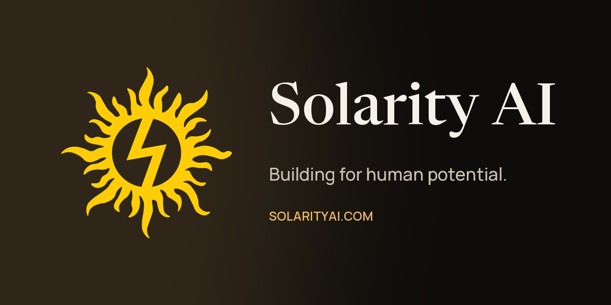

  

# Solarity AI public resources

Official, approved public materials for **Solarity AI LLC**, for press, partners, investors, and candidates: brand assets, press kit, company and product one-pagers, careers information, and links to our public policies.

**Start here:** [Download the press kit (ZIP)](https://solarityai.com/assets/press/solarity-ai-press-kit.zip) · [Full brand kit (release)](https://github.com/Solarity-AI/public-resources/releases/latest) · [Brand assets](brand/) · [Contact the founder](mailto:ata.turhan@solarityai.com)

> Solarity AI builds AI self-improvement apps and the tools that let its small team ship them fast.

Everything here mirrors **[solarityai.com](https://solarityai.com/?utm_source=github&utm_medium=public-resources&utm_campaign=readme)**, the source of truth. If this repository and the website ever disagree, the website wins. Please [open an issue](https://github.com/Solarity-AI/public-resources/issues/new/choose) so we can fix it.

## Quick downloads

| Asset | Format | Link |
| --- | --- | --- |
| Sun mark | PNG, 1024 × 1026, transparent | [Download sun mark](brand/logos/solarity-sun-mark.png?raw=true) |
| Sun mark on navy | PNG, 1200 × 1200 | [Download sun mark on navy](brand/logos/solarity-sun-mark-on-navy.png?raw=true) |
| Banner | PNG, 1280 × 640 | [Download banner](brand/banner/solarity-ai-banner-1280x640.png?raw=true) |
| Founder photo, Ata Turhan | JPEG, 800 × 800 | [Download founder photo](press-kit/images/ata-turhan-founder.jpg?raw=true) |
| App icons | PNG, 1024 × 1024 | [Browse app icons](press-kit/images/app-icons/) |
| Product screens | JPEG | [Browse product screens](press-kit/images/screens/) |
| Brand guidelines | Read before using the mark | [Read the brand rules](brand/brand-guidelines/) |
| Full press kit | ZIP, 3.1 MB | [Download press kit ZIP](https://solarityai.com/assets/press/solarity-ai-press-kit.zip) |

## What's inside

| Folder | Contents |
| --- | --- |
| [`brand/`](brand/) | Logo, banner, colors, typography, social profiles, and brand rules |
| [`press-kit/`](press-kit/) | Approved descriptions, company facts, founder bio, and images |
| [`one-pagers/`](one-pagers/) | Company, product, and SaaS one-pagers |
| [`pitch-decks/`](pitch-decks/) | Investor materials and how to request the current deck |
| [`careers/`](careers/) | Open roles and how to apply |
| [`demos/`](demos/) | Where to see the products: store listings, screens, and SaaS sites |
| [`legal-public/`](legal-public/) | Privacy policy, website data, accessibility, and terms |
| [`docs/standards/`](docs/standards/) | Internal standards for pitch decks and one-pagers |
| [`scripts/`](scripts/) | Checks, image generation, and release tooling. See [CONTRIBUTING.md](CONTRIBUTING.md) |

## Solarity AI at a glance

   

| Fact | Detail |
| --- | --- |
| **Company** | Solarity AI LLC, Dallas, Texas, United States |
| **Founder & CEO** | [Ata Turhan](press-kit/founder-bio/) · [ataturhan.com](https://ataturhan.com/) |
| **Team** | 7 people, founder-led |
| **Mobile apps** | Looks Max, IQ Max, Sleep Max, Fitness Max (listed as Only Fitness), all on the App Store and Google Play. 4 apps in 12 weeks, from June 23, 2026 |
| **SaaS products** | Engineering Max, Management Max, Marketing Max (all in early access) |

## Contact

| Topic | Where |
| --- | --- |
| Investors, partners, press, programs | [ata.turhan@solarityai.com](mailto:ata.turhan@solarityai.com) · [book a conversation](https://solarityai.com/contact/?utm_source=github&utm_medium=public-resources&utm_campaign=readme) |
| Careers | [careers@solarityai.com](mailto:careers@solarityai.com) · [solarityai.com/careers](https://solarityai.com/careers/?utm_source=github&utm_medium=public-resources&utm_campaign=readme) |
| Security issues | See [SECURITY.md](SECURITY.md) |

**Follow us:** [LinkedIn](https://www.linkedin.com/company/solarity-ai-company) · [X](https://x.com/solarity_ai) · [Instagram](https://www.instagram.com/solarity_ai) · [YouTube](https://www.youtube.com/@solarity_ai) · [Medium](https://medium.com/solarity-ai) · [TikTok](https://www.tiktok.com/@solarityai) · [all channels](brand/social-media/)

## Using these materials

Press, partners, and program organizers may use the materials in `brand/` and `press-kit/` to write about Solarity AI, as long as they follow the [brand rules](brand/brand-guidelines/). Everything else is © Solarity AI LLC, all rights reserved. See [LICENSE.md](LICENSE.md).

See what changed recently in the [changelog](CHANGELOG.md). Want to propose a change? Read [CONTRIBUTING.md](CONTRIBUTING.md). All changes go through a reviewed pull request.
