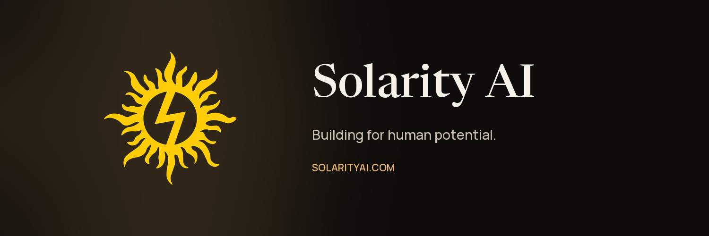

# Banners

Wide banners in the [solarityai.com](https://solarityai.com/?utm_source=github&utm_medium=public-resources&utm_campaign=brand-banner) style: the sun mark, the name in Newsreader, and the tagline in Manrope on the navy logo background.

| File | Size | Use |
| --- | --- | --- |
| [solarity-ai-banner-1280x640.png](solarity-ai-banner-1280x640.png) | 1280 × 640 | GitHub social preview, README headers, link previews |
| [solarity-ai-banner-1500x500.png](solarity-ai-banner-1500x500.png) | 1500 × 500 | X (Twitter) header and other wide profile headers |

The tagline, *Building for human potential.*, is the headline on the solarityai.com home page.

The previous navy "SOLARITY / ALWAYS BETTER" banner and logo have been retired. Don't use them. They are kept only in the [`legacy-brand-2026.04`](https://github.com/Solarity-AI/public-resources/releases/tag/legacy-brand-2026.04) release for reference.

---

[← All public resources](../../) · Questions? [ata.turhan@solarityai.com](mailto:ata.turhan@solarityai.com)
