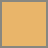
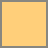
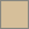
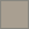
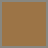
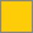

# Colors

The palette used on [solarityai.com](https://solarityai.com/?utm_source=github&utm_medium=public-resources&utm_campaign=brand-colors): a warm, dark background, cream text, and gold accents. The logo has its own navy background.

## Core

| Swatch | Name | Value | Use |
| --- | --- | --- | --- |
| <picture></picture> | Night | `#0F0D0B`<br>RGB 15, 13, 11 | Page background, theme color |
| <picture></picture> | Cream | `#F5F1E8`<br>RGB 245, 241, 232 | Headings and body text |
| <picture></picture> | Stone | `#C9C0B2`<br>RGB 201, 192, 178 | Secondary text |
| <picture></picture> | Gold | `#E9B56A`<br>RGB 233, 181, 106 | Links and accents |

## Supporting

| Swatch | Name | Value | Use |
| --- | --- | --- | --- |
| <picture></picture> | Light gold | `#FFCF7A`<br>RGB 255, 207, 122 | Primary buttons, focus ring, highlighted words |
| <picture></picture> | Sand | `#D6BF9A`<br>RGB 214, 191, 154 | Labels, eyebrow text |
| <picture></picture> | Taupe | `#A99F91`<br>RGB 169, 159, 145 | Tertiary text, captions |
| <picture></picture> | Bronze | `#9C7446`<br>RGB 156, 116, 70 | Subtle accents |
| <picture></picture> | Umber | `#2A231C`<br>RGB 42, 35, 28 | Borders, dividers |
| <picture></picture> | Raised | `#221C16`<br>RGB 34, 28, 22 | Raised surfaces |
| <picture></picture> | Ink | `#1A140E`<br>RGB 26, 20, 14 | Text on Light gold buttons |
| <picture></picture> | Ember | `#D9782F`<br>RGB 217, 120, 47 | Warm glow in the page lighting |

## Logo navy

The background of the sun mark, banners, and profile pictures: a glow from Navy at the center to Deep navy at the edges, taken from the original Solarity logo.

| Swatch | Name | Value | Use |
| --- | --- | --- | --- |
| <picture></picture> | Navy | `#1F225C`<br>RGB 31, 34, 92 | Center of the logo glow |
| <picture></picture> | Deep navy | `#0D1120`<br>RGB 13, 17, 32 | Edges of the logo glow |

## Sun mark

| Swatch | Name | Value |
| --- | --- | --- |
| <picture></picture> | Sun yellow | `#FFCD07`<br>RGB 255, 205, 7 |

Sun yellow belongs to the logo. Use it in the mark only, not as an interface color.

## CSS

```css
:root {
  --night: #0F0D0B;
  --cream: #F5F1E8;
  --stone: #C9C0B2;
  --gold: #E9B56A;
  --light-gold: #FFCF7A;
  --sand: #D6BF9A;
  --taupe: #A99F91;
  --bronze: #9C7446;
  --umber: #2A231C;
  --raised: #221C16;
  --ink: #1A140E;
  --ember: #D9782F;
  --navy: #1F225C;
  --navy-deep: #0D1120;
}
```

---

[← All public resources](../../) · Questions? [ata.turhan@solarityai.com](mailto:ata.turhan@solarityai.com)
