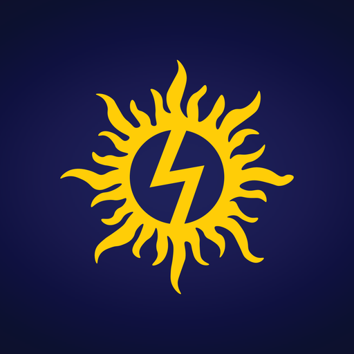

# Logos

The **Solarity AI sun mark** is the company's logo. The master file is the official press-kit file from [solarityai.com/press](https://solarityai.com/press/?utm_source=github&utm_medium=public-resources&utm_campaign=brand-logos).

| File | Size | Use |
| --- | --- | --- |
| [`solarity-sun-mark.png`](solarity-sun-mark.png) | 1024 × 1026, transparent | Master file: print, presentations, press |
| [`solarity-sun-mark-512.png`](solarity-sun-mark-512.png) | 512 px wide, transparent | Web pages, documents |
| [`solarity-sun-mark-256.png`](solarity-sun-mark-256.png) | 256 px wide, transparent | Avatars, listings |
| [`solarity-sun-mark-192.png`](solarity-sun-mark-192.png) | 192 px wide, transparent | App and web icons |
| [`solarity-sun-mark-64.png`](solarity-sun-mark-64.png) | 64 px wide, transparent | Favicons, small UI |
| [`solarity-sun-mark-on-navy.png`](solarity-sun-mark-on-navy.png) | 1200 × 1200, on navy | Profile pictures (GitHub, LinkedIn, X), square placements |
| [`solarity-sun-mark-on-navy-512.png`](solarity-sun-mark-on-navy-512.png) | 512 × 512, on navy | Light pages and documents where the transparent mark loses contrast |
| [`solarity-sun-mark-on-navy-192.png`](solarity-sun-mark-on-navy-192.png) | 192 × 192, on navy | Small placements on light backgrounds, such as GitHub in light mode |

The smaller files are scaled-down copies of the master. They are not redrawn or recolored.

## Usage

- Use the mark as supplied. Don't recolor, stretch, rotate, outline, or redraw it.
- Leave clear space around it equal to at least a quarter of its width.
- Its background is the navy glow (`#1F225C` to `#0D1120`), taken from the original Solarity logo. Use the navy versions wherever the mark needs a background.
- No vector (SVG) or single-color version has been published yet. For one, email [ata.turhan@solarityai.com](mailto:ata.turhan@solarityai.com).

---

[← All public resources](../../) · Questions? [ata.turhan@solarityai.com](mailto:ata.turhan@solarityai.com)
