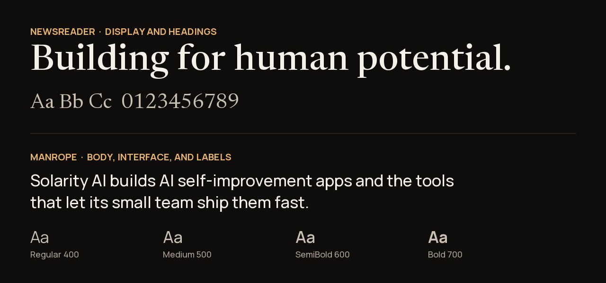

# Typography

[solarityai.com](https://solarityai.com/) uses 2 typefaces. Both are free under the SIL Open Font License.



| Role | Typeface | Fallbacks | Get it |
| --- | --- | --- | --- |
| Display and headings | **Newsreader** (serif) | Georgia, serif | [Google Fonts](https://fonts.google.com/specimen/Newsreader) |
| Body, interface, and labels | **Manrope** (sans-serif) | Arial, sans-serif | [Google Fonts](https://fonts.google.com/specimen/Manrope) |

## How they work together

- **Newsreader** carries the voice: large, short headlines such as *Building for human potential.*
- **Manrope** carries the information: paragraphs, buttons, navigation, and data.
- Small labels and eyebrow text use Manrope in capitals with a little extra letter spacing.

## CSS

```css
font-family: Newsreader, Georgia, serif;      /* headings */
font-family: Manrope, Arial, sans-serif;      /* body */
```

---

[← All public resources](../../) · Questions? [ata.turhan@solarityai.com](mailto:ata.turhan@solarityai.com)
