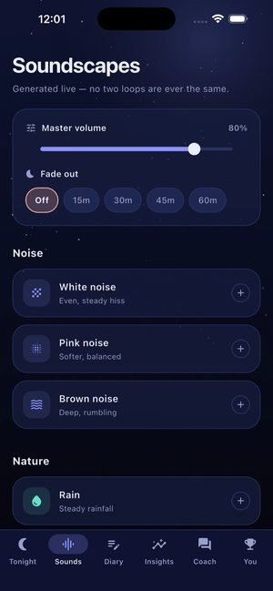
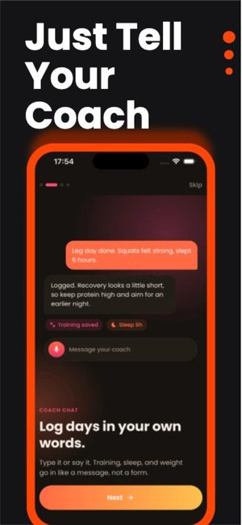

# Screenshots

Official product screens live in the press kit so there is only one copy of each: **[`press-kit/images/screens/`](../../press-kit/images/screens/)**.

  
  
  
  

The app screens are official App Store images with sample content. The SaaS screens ([Engineering Max](../../press-kit/images/screens/engineering-max-screen.jpg), [Management Max](../../press-kit/images/screens/management-max-screen.jpg), [Marketing Max](../../press-kit/images/screens/marketing-max-screen.jpg)) come from each product's own site. Engineering Max shows its scan of Solarity AI's own Sleep Max, and Management Max and Marketing Max show sample data.

---

[← All public resources](../../) · Questions? [ata.turhan@solarityai.com](mailto:ata.turhan@solarityai.com)
